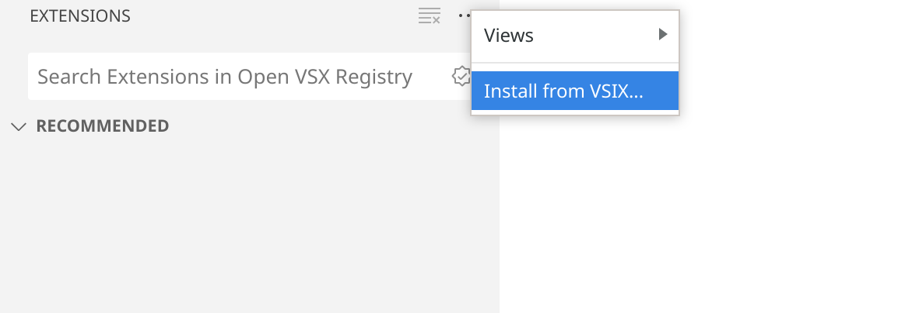

# Renode VSCode Extension

Copyright (c) 2026 [Antmicro](https://antmicro.com)

Renode Extensions for [Visual Studio Code](https://code.visualstudio.com/) and [Theia](https://theia-ide.org), allowing users to easily integrate with [Renode](https://antmicro.com/platforms/renode/), an open source simulation framework for embedded systems.

## Features

- Enables emulating and debugging projects in Renode directly from the editor.
- Web extension compatibility - most features work seamlessly in pure web environments, like vscode.dev.

## Requirements

- [Renode](https://github.com/renode/renode) (the extension can either connect to a local copy or download the Renode build matching its version, for Windows or Linux).
- GDB, with support for the architecture you are planning to debug.

## Installing the extension

The extension can be installed from the [Visual Studio Code Marketplace](https://marketplace.visualstudio.com/items?itemName=Antmicro.renode).

## Building and manual installation

To build the extension, use `pnpm`:

```
pnpm i && pnpm run v:pack
```

This will produce a `renode*.vsix` file you can install in your IDE.

You can install it in the `Extension` tab, with the `Install from VSIX` option.



## Connecting to Renode from pure web editors

In pure web environments (like vscode.dev), the extension cannot automatically start Renode and needs to connect to a running instance using a WebSocket.

To do that, start Renode in server mode:

```sh
renode --server-mode
```

If both Renode and the web environment are on the same machine, the extension will pick up the running server automatically.
In other cases, the WebSocket URI can be changed in the extension's settings using `Default Session Uri`.

## Plugin configuration

Here is the sample configuration file you can place in `.vscode/launch.json` or `.theia/launch.json`:

```json
{
  "version": "0.2.0",
  "configurations": [
    {
      "type": "renodegdb",
      "request": "launch",
      "name": "Debug in Renode",
      "elf": "${workspaceFolder}/path/to/your/binary.elf",
      "gdb": "gdb-multiarch" /* provide the binary for GDB you would like to use */,

      "resc": "${workspaceFolder}/your.resc",

      "cwd": "${workspaceFolder}",
      "terminals": [
        "ws://127.0.0.1:21234/monitor", // Monitor
        "ws://127.0.0.1:21234/logs" // Log
      ]
    }
  ]
}
```
